# Date & Time Functions Relationship Diagram

This diagram shows the relationships between functions in the Date & Time category and their connections to commonly used functions. It shows 25 of the 26 Date & Time functions. EPOCHTODATE is not shown.

```mermaid
graph TD
    classDef DateTime fill:#FF9FF3,stroke:#333,stroke-width:2px,color:#000
    ISOWEEKNUM["ISOWEEKNUM<br/>Returns the ISO 8601 week number of a date"]
    MINUTE["MINUTE<br/>Returns the minute of a time, from 0 to 59"]
    HOUR["HOUR<br/>Returns the hour of a time, from 0 to 23"]
    WEEKNUM["WEEKNUM<br/>Returns the week number of the year for a date"]
    NETWORKDAYS_INTL["NETWORKDAYS.INTL<br/>Counts working days with custom weekend days"]
    TIMEVALUE["TIMEVALUE<br/>Converts a text time to a decimal fraction of a day"]
    WORKDAY["WORKDAY<br/>Returns the date a number of working days away"]
    TODAY["TODAY<br/>Returns the current date as a serial number"]
    DAY["DAY<br/>Returns the day of the month, from 1 to 31"]
    DATEVALUE["DATEVALUE<br/>Converts a date stored as text to a date value"]
    NETWORKDAYS["NETWORKDAYS<br/>Counts whole working days between two dates"]
    WORKDAY_INTL["WORKDAY.INTL<br/>Returns a date offset by working days, with custom weekends"]
    DATE["DATE<br/>Builds a date from a year, month and day"]
    MONTH["MONTH<br/>Returns the month of a date, from 1 to 12"]
    DATEDIF["DATEDIF<br/>Returns the difference between two dates in a chosen unit"]
    EOMONTH["EOMONTH<br/>Returns the last day of a month, offset by months"]
    YEAR["YEAR<br/>YEAR extracts the year from a date as a four-digit number."]
    YEARFRAC["YEARFRAC<br/>Returns the fraction of a year between two dates"]
    TIME["TIME<br/>Builds a time value from an hour, minute and second"]
    DAYS360["DAYS360<br/>Counts days between two dates on a 360-day year"]
    WEEKDAY["WEEKDAY<br/>Returns the day of the week for a date, as a number"]
    NOW["NOW<br/>Returns the current date and time as a serial number"]
    DAYS["DAYS<br/>Returns the number of calendar days between two dates"]
    EDATE["EDATE<br/>Returns a date offset by a number of months"]
    SECOND["SECOND<br/>Returns the second of a time, from 0 to 59"]
    IF["IF<br/>External Function"]
    ISOWEEKNUM --> IF
    class IF external
    SUM["SUM<br/>External Function"]
    ISOWEEKNUM --> SUM
    class SUM external
    AVERAGE["AVERAGE<br/>External Function"]
    ISOWEEKNUM --> AVERAGE
    class AVERAGE external
    IF["IF<br/>Related Function"]
    ISOWEEKNUM -.-> IF
    class IF external
    IFERROR["IFERROR<br/>Related Function"]
    ISOWEEKNUM -.-> IFERROR
    class IFERROR external
    MINUTE --> TODAY
    IF["IF<br/>External Function"]
    MINUTE --> IF
    class IF external
    MINUTE --> YEAR
    MINUTE -.-> TODAY
    MINUTE -.-> NOW
    HOUR --> TODAY
    IF["IF<br/>External Function"]
    HOUR --> IF
    class IF external
    HOUR --> YEAR
    HOUR -.-> TODAY
    HOUR -.-> NOW
    IF["IF<br/>External Function"]
    WEEKNUM --> IF
    class IF external
    SUM["SUM<br/>External Function"]
    WEEKNUM --> SUM
    class SUM external
    AVERAGE["AVERAGE<br/>External Function"]
    WEEKNUM --> AVERAGE
    class AVERAGE external
    IF["IF<br/>Related Function"]
    WEEKNUM -.-> IF
    class IF external
    IFERROR["IFERROR<br/>Related Function"]
    WEEKNUM -.-> IFERROR
    class IFERROR external
    IF["IF<br/>External Function"]
    NETWORKDAYS_INTL --> IF
    class IF external
    SUM["SUM<br/>External Function"]
    NETWORKDAYS_INTL --> SUM
    class SUM external
    AVERAGE["AVERAGE<br/>External Function"]
    NETWORKDAYS_INTL --> AVERAGE
    class AVERAGE external
    IF["IF<br/>Related Function"]
    NETWORKDAYS_INTL -.-> IF
    class IF external
    IFERROR["IFERROR<br/>Related Function"]
    NETWORKDAYS_INTL -.-> IFERROR
    class IFERROR external
    TIMEVALUE --> TODAY
    IF["IF<br/>External Function"]
    TIMEVALUE --> IF
    class IF external
    TIMEVALUE --> YEAR
    TIMEVALUE -.-> TODAY
    TIMEVALUE -.-> NOW
    IF["IF<br/>External Function"]
    WORKDAY --> IF
    class IF external
    SUM["SUM<br/>External Function"]
    WORKDAY --> SUM
    class SUM external
    AVERAGE["AVERAGE<br/>External Function"]
    WORKDAY --> AVERAGE
    class AVERAGE external
    IF["IF<br/>Related Function"]
    WORKDAY -.-> IF
    class IF external
    IFERROR["IFERROR<br/>Related Function"]
    WORKDAY -.-> IFERROR
    class IFERROR external
    IF["IF<br/>External Function"]
    TODAY --> IF
    class IF external
    TODAY --> YEAR
    TODAY --> MONTH
    TODAY -.-> NOW
    TODAY -.-> DATE
    DAY --> TODAY
    IF["IF<br/>External Function"]
    DAY --> IF
    class IF external
    DAY --> YEAR
    DAY -.-> TODAY
    DAY -.-> NOW
    DATEVALUE --> TODAY
    IF["IF<br/>External Function"]
    DATEVALUE --> IF
    class IF external
    DATEVALUE --> YEAR
    DATEVALUE -.-> TODAY
    DATEVALUE -.-> NOW
    IF["IF<br/>External Function"]
    NETWORKDAYS --> IF
    class IF external
    SUM["SUM<br/>External Function"]
    NETWORKDAYS --> SUM
    class SUM external
    AVERAGE["AVERAGE<br/>External Function"]
    NETWORKDAYS --> AVERAGE
    class AVERAGE external
    IF["IF<br/>Related Function"]
    NETWORKDAYS -.-> IF
    class IF external
    IFERROR["IFERROR<br/>Related Function"]
    NETWORKDAYS -.-> IFERROR
    class IFERROR external
    IF["IF<br/>External Function"]
    WORKDAY_INTL --> IF
    class IF external
    SUM["SUM<br/>External Function"]
    WORKDAY_INTL --> SUM
    class SUM external
    AVERAGE["AVERAGE<br/>External Function"]
    WORKDAY_INTL --> AVERAGE
    class AVERAGE external
    IF["IF<br/>Related Function"]
    WORKDAY_INTL -.-> IF
    class IF external
    IFERROR["IFERROR<br/>Related Function"]
    WORKDAY_INTL -.-> IFERROR
    class IFERROR external
    DATE --> TODAY
    IF["IF<br/>External Function"]
    DATE --> IF
    class IF external
    DATE --> YEAR
    DATE -.-> TODAY
    DATE -.-> NOW
    MONTH --> TODAY
    IF["IF<br/>External Function"]
    MONTH --> IF
    class IF external
    MONTH --> YEAR
    MONTH -.-> TODAY
    MONTH -.-> NOW
    IF["IF<br/>External Function"]
    DATEDIF --> IF
    class IF external
    SUM["SUM<br/>External Function"]
    DATEDIF --> SUM
    class SUM external
    COUNT["COUNT<br/>External Function"]
    DATEDIF --> COUNT
    class COUNT external
    IF["IF<br/>Related Function"]
    DATEDIF -.-> IF
    class IF external
    SUMIF["SUMIF<br/>Related Function"]
    DATEDIF -.-> SUMIF
    class SUMIF external
    IF["IF<br/>External Function"]
    EOMONTH --> IF
    class IF external
    SUM["SUM<br/>External Function"]
    EOMONTH --> SUM
    class SUM external
    AVERAGE["AVERAGE<br/>External Function"]
    EOMONTH --> AVERAGE
    class AVERAGE external
    IF["IF<br/>Related Function"]
    EOMONTH -.-> IF
    class IF external
    IFERROR["IFERROR<br/>Related Function"]
    EOMONTH -.-> IFERROR
    class IFERROR external
    IF["IF<br/>External Function"]
    YEAR --> IF
    class IF external
    YEAR --> TODAY
    YEAR --> DATE
    YEAR -.-> MONTH
    YEAR -.-> DAY
    IF["IF<br/>External Function"]
    YEARFRAC --> IF
    class IF external
    SUM["SUM<br/>External Function"]
    YEARFRAC --> SUM
    class SUM external
    AVERAGE["AVERAGE<br/>External Function"]
    YEARFRAC --> AVERAGE
    class AVERAGE external
    IF["IF<br/>Related Function"]
    YEARFRAC -.-> IF
    class IF external
    IFERROR["IFERROR<br/>Related Function"]
    YEARFRAC -.-> IFERROR
    class IFERROR external
    TIME --> TODAY
    IF["IF<br/>External Function"]
    TIME --> IF
    class IF external
    TIME --> YEAR
    TIME -.-> TODAY
    TIME -.-> NOW
    IF["IF<br/>External Function"]
    DAYS360 --> IF
    class IF external
    SUM["SUM<br/>External Function"]
    DAYS360 --> SUM
    class SUM external
    AVERAGE["AVERAGE<br/>External Function"]
    DAYS360 --> AVERAGE
    class AVERAGE external
    IF["IF<br/>Related Function"]
    DAYS360 -.-> IF
    class IF external
    IFERROR["IFERROR<br/>Related Function"]
    DAYS360 -.-> IFERROR
    class IFERROR external
    IF["IF<br/>External Function"]
    WEEKDAY --> IF
    class IF external
    SUM["SUM<br/>External Function"]
    WEEKDAY --> SUM
    class SUM external
    AVERAGE["AVERAGE<br/>External Function"]
    WEEKDAY --> AVERAGE
    class AVERAGE external
    IF["IF<br/>Related Function"]
    WEEKDAY -.-> IF
    class IF external
    IFERROR["IFERROR<br/>Related Function"]
    WEEKDAY -.-> IFERROR
    class IFERROR external
    IF["IF<br/>External Function"]
    NOW --> IF
    class IF external
    INT["INT<br/>External Function"]
    NOW --> INT
    class INT external
    NOW --> TIME
    NOW -.-> TODAY
    NOW -.-> TIME
    IF["IF<br/>External Function"]
    DAYS --> IF
    class IF external
    SUM["SUM<br/>External Function"]
    DAYS --> SUM
    class SUM external
    AVERAGE["AVERAGE<br/>External Function"]
    DAYS --> AVERAGE
    class AVERAGE external
    IF["IF<br/>Related Function"]
    DAYS -.-> IF
    class IF external
    IFERROR["IFERROR<br/>Related Function"]
    DAYS -.-> IFERROR
    class IFERROR external
    EDATE --> TODAY
    IF["IF<br/>External Function"]
    EDATE --> IF
    class IF external
    EDATE --> YEAR
    EDATE -.-> TODAY
    EDATE -.-> NOW
    SECOND --> TODAY
    IF["IF<br/>External Function"]
    SECOND --> IF
    class IF external
    SECOND --> YEAR
    SECOND -.-> TODAY
    SECOND -.-> NOW
    class ISOWEEKNUM DateTime
    class MINUTE DateTime
    class HOUR DateTime
    class WEEKNUM DateTime
    class NETWORKDAYS_INTL DateTime
    class TIMEVALUE DateTime
    class WORKDAY DateTime
    class TODAY DateTime
    class DAY DateTime
    class DATEVALUE DateTime
    class NETWORKDAYS DateTime
    class WORKDAY_INTL DateTime
    class DATE DateTime
    class MONTH DateTime
    class DATEDIF DateTime
    class EOMONTH DateTime
    class YEAR DateTime
    class YEARFRAC DateTime
    class TIME DateTime
    class DAYS360 DateTime
    class WEEKDAY DateTime
    class NOW DateTime
    class DAYS DateTime
    class EDATE DateTime
    class SECOND DateTime
    classDef external fill:#f9f9f9,stroke:#666,stroke-width:1px,stroke-dasharray: 5 5
```

## Legend
- **Solid arrows (→)**: "Commonly used with" relationships
- **Dashed arrows** (`-.->`): "Similar functions" relationships
- **Colored nodes**: Functions in this category
- **Gray dashed nodes**: External functions from other categories

## Functions in This Category: 26
