# Dynamic Arrays Functions Relationship Diagram

This diagram groups dynamic array functions. Each function now lives in its official category, listed in the table below. The grouping is kept here for reference.

| Folder | Functions |
| --- | --- |
| `Functions/Logical` | LET |
| `Functions/Lookup & Reference` | FILTER, SORT, TAKE, UNIQUE, XLOOKUP, XMATCH |

5 of the 7 functions also work in Google Sheets. Excel only: TAKE, XMATCH.

```mermaid
graph TD
    classDef DynamicArrays fill:#FD79A8,stroke:#333,stroke-width:2px,color:#000
    TAKE["TAKE<br/>Returns rows or columns from the start or end of an array"]
    FILTER["FILTER<br/>Filters a range of data based on criteria you define"]
    XLOOKUP["XLOOKUP<br/>Searches a range or array and returns the matching item"]
    LET["LET<br/>Assigns names to calculation results"]
    XMATCH["XMATCH<br/>Returns the relative position of an item in a range"]
    SORT["SORT<br/>Sorts the contents of a range or array"]
    UNIQUE["UNIQUE<br/>Returns a list of unique values in a list or range"]
    IF["IF<br/>External Function"]
    TAKE --> IF
    class IF external
    SUM["SUM<br/>External Function"]
    TAKE --> SUM
    class SUM external
    AVERAGE["AVERAGE<br/>External Function"]
    TAKE --> AVERAGE
    class AVERAGE external
    IF["IF<br/>External Function"]
    TAKE -.-> IF
    class IF external
    IFERROR["IFERROR<br/>External Function"]
    TAKE -.-> IFERROR
    class IFERROR external
    IF["IF<br/>External Function"]
    FILTER --> IF
    class IF external
    SUM["SUM<br/>External Function"]
    FILTER --> SUM
    class SUM external
    AVERAGE["AVERAGE<br/>External Function"]
    FILTER --> AVERAGE
    class AVERAGE external
    IF["IF<br/>External Function"]
    FILTER -.-> IF
    class IF external
    IFERROR["IFERROR<br/>External Function"]
    FILTER -.-> IFERROR
    class IFERROR external
    IF["IF<br/>External Function"]
    XLOOKUP --> IF
    class IF external
    SUM["SUM<br/>External Function"]
    XLOOKUP --> SUM
    class SUM external
    AVERAGE["AVERAGE<br/>External Function"]
    XLOOKUP --> AVERAGE
    class AVERAGE external
    IF["IF<br/>External Function"]
    XLOOKUP -.-> IF
    class IF external
    IFERROR["IFERROR<br/>External Function"]
    XLOOKUP -.-> IFERROR
    class IFERROR external
    IF["IF<br/>External Function"]
    LET --> IF
    class IF external
    SUM["SUM<br/>External Function"]
    LET --> SUM
    class SUM external
    AVERAGE["AVERAGE<br/>External Function"]
    LET --> AVERAGE
    class AVERAGE external
    IF["IF<br/>External Function"]
    LET -.-> IF
    class IF external
    IFERROR["IFERROR<br/>External Function"]
    LET -.-> IFERROR
    class IFERROR external
    IF["IF<br/>External Function"]
    XMATCH --> IF
    class IF external
    SUM["SUM<br/>External Function"]
    XMATCH --> SUM
    class SUM external
    AVERAGE["AVERAGE<br/>External Function"]
    XMATCH --> AVERAGE
    class AVERAGE external
    IF["IF<br/>External Function"]
    XMATCH -.-> IF
    class IF external
    IFERROR["IFERROR<br/>External Function"]
    XMATCH -.-> IFERROR
    class IFERROR external
    IF["IF<br/>External Function"]
    SORT --> IF
    class IF external
    SUM["SUM<br/>External Function"]
    SORT --> SUM
    class SUM external
    AVERAGE["AVERAGE<br/>External Function"]
    SORT --> AVERAGE
    class AVERAGE external
    IF["IF<br/>External Function"]
    SORT -.-> IF
    class IF external
    IFERROR["IFERROR<br/>External Function"]
    SORT -.-> IFERROR
    class IFERROR external
    IF["IF<br/>External Function"]
    UNIQUE --> IF
    class IF external
    SUM["SUM<br/>External Function"]
    UNIQUE --> SUM
    class SUM external
    AVERAGE["AVERAGE<br/>External Function"]
    UNIQUE --> AVERAGE
    class AVERAGE external
    IF["IF<br/>External Function"]
    UNIQUE -.-> IF
    class IF external
    IFERROR["IFERROR<br/>External Function"]
    UNIQUE -.-> IFERROR
    class IFERROR external
    class TAKE DynamicArrays
    class FILTER DynamicArrays
    class XLOOKUP DynamicArrays
    class LET DynamicArrays
    class XMATCH DynamicArrays
    class SORT DynamicArrays
    class UNIQUE DynamicArrays
    classDef external fill:#f9f9f9,stroke:#666,stroke-width:1px,stroke-dasharray: 5 5
```

## Legend
- **Solid arrows (→)**: "Commonly used with" relationships
- **Dashed arrows (`-.->`)**: "Similar functions" relationships
- **Colored nodes**: Functions in this category
- **Gray dashed nodes**: External functions from other categories

## Functions in This Diagram: 7
