# Excel-Specific Functions

This diagram lists functions that were once grouped as Excel-specific. Each function now lives in its official category, listed in the table below. The grouping is kept here for reference.

| Folder | Functions |
| --- | --- |
| `Functions/Information` | STOCKHISTORY |
| `Functions/Logical` | LAMBDA, LET |
| `Functions/Lookup & Reference` | FILTER, SORT, SORTBY, UNIQUE |
| `Functions/Math & Trig` | RANDARRAY, SEQUENCE |
| `Functions/Text` | CONCAT, TEXTJOIN |
| `Functions/Web` | FILTERXML, WEBSERVICE |

9 of the 13 functions also work in Google Sheets. Excel only: FILTERXML, SORTBY, STOCKHISTORY, WEBSERVICE.

```mermaid

graph LR
    ExcelSpecific["<div align='left' style='font-family: MonoLisa, monospace;'><b style='font-size: 1.1em;'>Excel-Specific</b><br/>────────────────<br/>Functions once grouped as Excel-specific<br/><b>Total Functions:</b> 13</div>"]

    ExcelSpecific --> ArrayOperations["<div align='left' style='font-family: MonoLisa, monospace;'><b style='font-size: 1.1em;'>Array Operations</b><br/>────────────────<br/>Advanced array manipulation<br/><b>Functions:</b> 4</div>"]
    ExcelSpecific --> DynamicArraysExcel["<div align='left' style='font-family: MonoLisa, monospace;'><b style='font-size: 1.1em;'>Dynamic Arrays</b><br/>────────────────<br/>Dynamic array functions<br/><b>Functions:</b> 2</div>"]
    ExcelSpecific --> StockData["<div align='left' style='font-family: MonoLisa, monospace;'><b style='font-size: 1.1em;'>Stock Data</b><br/>────────────────<br/>Stock data retrieval (Information category)<br/><b>Functions:</b> 1</div>"]
    ExcelSpecific --> TextProcessingExcel["<div align='left' style='font-family: MonoLisa, monospace;'><b style='font-size: 1.1em;'>Text Processing</b><br/>────────────────<br/>Excel text functions<br/><b>Functions:</b> 2</div>"]
    ExcelSpecific --> WebDataExcel["<div align='left' style='font-family: MonoLisa, monospace;'><b style='font-size: 1.1em;'>Web Data</b><br/>────────────────<br/>Web data retrieval<br/><b>Functions:</b> 2</div>"]
    ExcelSpecific --> NewFunctionsExcel["<div align='left' style='font-family: MonoLisa, monospace;'><b style='font-size: 1.1em;'>New Functions</b><br/>────────────────<br/>Latest Excel functions<br/><b>Functions:</b> 2</div>"]

    ArrayOperations --> SORT["<div align='left' style='font-family: MonoLisa, monospace;'><b>SORT</b><br/>────────────────<br/>Sorts the contents of a range or array</div>"]
    SORT --> SORTSYNTAX["<div align='left' style='font-family: MonoLisa, monospace;'><b>Syntax</b><br/>────────────────<br/>SORT(array, [sort_index], [sort_order], [by_col])</div>"]
    SORT --> SORTEXAMPLE["<div align='left' style='font-family: MonoLisa, monospace;'><b>Example</b><br/>────────────────<br/>=SORT(A1:B10, 1, 1) → Sorted array</div>"]
    ArrayOperations --> SORTBY["<div align='left' style='font-family: MonoLisa, monospace;'><b>SORTBY</b><br/>────────────────<br/>Sorts a range or array by values in a corresponding range</div>"]
    SORTBY --> SORTBYSYNTAX["<div align='left' style='font-family: MonoLisa, monospace;'><b>Syntax</b><br/>────────────────<br/>SORTBY(array, by_array1, [sort_order1], [by_array2, sort_order2], …)</div>"]
    SORTBY --> SORTBYEXAMPLE["<div align='left' style='font-family: MonoLisa, monospace;'><b>Example</b><br/>────────────────<br/>=SORTBY(A1:A10, B1:B10, -1) → Sorted array</div>"]
    ArrayOperations --> UNIQUE_EXCEL["<div align='left' style='font-family: MonoLisa, monospace;'><b>UNIQUE</b><br/>────────────────<br/>Returns a list of unique values in a list or range</div>"]
    UNIQUE_EXCEL --> UNIQUE_EXCELSYNTAX["<div align='left' style='font-family: MonoLisa, monospace;'><b>Syntax</b><br/>────────────────<br/>UNIQUE(array, [by_col], [exactly_once])</div>"]
    UNIQUE_EXCEL --> UNIQUE_EXCELEXAMPLE["<div align='left' style='font-family: MonoLisa, monospace;'><b>Example</b><br/>────────────────<br/>=UNIQUE(A1:A10) → Unique values</div>"]
    ArrayOperations --> FILTER_EXCEL["<div align='left' style='font-family: MonoLisa, monospace;'><b>FILTER</b><br/>────────────────<br/>Filters a range of data based on criteria you define</div>"]
    FILTER_EXCEL --> FILTER_EXCELSYNTAX["<div align='left' style='font-family: MonoLisa, monospace;'><b>Syntax</b><br/>────────────────<br/>FILTER(array, include, [if_empty])</div>"]
    FILTER_EXCEL --> FILTER_EXCELEXAMPLE["<div align='left' style='font-family: MonoLisa, monospace;'><b>Example</b><br/>────────────────<br/>=FILTER(A1:B10, A1:A10&gt;5) → Filtered array</div>"]

    DynamicArraysExcel --> SEQUENCE_EXCEL["<div align='left' style='font-family: MonoLisa, monospace;'><b>SEQUENCE</b><br/>────────────────<br/>Generates a list of sequential numbers in an array</div>"]
    SEQUENCE_EXCEL --> SEQUENCE_EXCELSYNTAX["<div align='left' style='font-family: MonoLisa, monospace;'><b>Syntax</b><br/>────────────────<br/>SEQUENCE(rows, [columns], [start], [step])</div>"]
    SEQUENCE_EXCEL --> SEQUENCE_EXCELEXAMPLE["<div align='left' style='font-family: MonoLisa, monospace;'><b>Example</b><br/>────────────────<br/>=SEQUENCE(5, 1, 1, 2) → {1;3;5;7;9}</div>"]
    DynamicArraysExcel --> RANDARRAY_EXCEL["<div align='left' style='font-family: MonoLisa, monospace;'><b>RANDARRAY</b><br/>────────────────<br/>Returns an array of random numbers</div>"]
    RANDARRAY_EXCEL --> RANDARRAY_EXCELSYNTAX["<div align='left' style='font-family: MonoLisa, monospace;'><b>Syntax</b><br/>────────────────<br/>RANDARRAY([rows], [columns], [min], [max], [integer])</div>"]
    RANDARRAY_EXCEL --> RANDARRAY_EXCELEXAMPLE["<div align='left' style='font-family: MonoLisa, monospace;'><b>Example</b><br/>────────────────<br/>=RANDARRAY(3, 2, 1, 10, TRUE) → Random array</div>"]

    StockData --> STOCKHISTORY_EXCEL["<div align='left' style='font-family: MonoLisa, monospace;'><b>STOCKHISTORY</b><br/>────────────────<br/>Retrieves historical data for a financial instrument</div>"]
    STOCKHISTORY_EXCEL --> STOCKHISTORY_EXCELSYNTAX["<div align='left' style='font-family: MonoLisa, monospace;'><b>Syntax</b><br/>────────────────<br/>STOCKHISTORY(stock, start_date, [end_date], [interval], [headers], [properties])</div>"]
    STOCKHISTORY_EXCEL --> STOCKHISTORY_EXCELEXAMPLE["<div align='left' style='font-family: MonoLisa, monospace;'><b>Example</b><br/>────────────────<br/>=STOCKHISTORY(&quot;MSFT&quot;, TODAY()-365) → Stock data</div>"]

    TextProcessingExcel --> TEXTJOIN_EXCEL["<div align='left' style='font-family: MonoLisa, monospace;'><b>TEXTJOIN</b><br/>────────────────<br/>Combines text from multiple ranges with a delimiter</div>"]
    TEXTJOIN_EXCEL --> TEXTJOIN_EXCELSYNTAX["<div align='left' style='font-family: MonoLisa, monospace;'><b>Syntax</b><br/>────────────────<br/>TEXTJOIN(delimiter, ignore_empty, text1, [text2], ...)</div>"]
    TEXTJOIN_EXCEL --> TEXTJOIN_EXCELEXAMPLE["<div align='left' style='font-family: MonoLisa, monospace;'><b>Example</b><br/>────────────────<br/>=TEXTJOIN(&quot;, &quot;, TRUE, A1:A5) → &quot;Apple, Banana, Cherry&quot;</div>"]
    TextProcessingExcel --> CONCAT_EXCEL["<div align='left' style='font-family: MonoLisa, monospace;'><b>CONCAT</b><br/>────────────────<br/>Combines text from multiple ranges</div>"]
    CONCAT_EXCEL --> CONCAT_EXCELSYNTAX["<div align='left' style='font-family: MonoLisa, monospace;'><b>Syntax</b><br/>────────────────<br/>CONCAT(text1, [text2], ...)</div>"]
    CONCAT_EXCEL --> CONCAT_EXCELEXAMPLE["<div align='left' style='font-family: MonoLisa, monospace;'><b>Example</b><br/>────────────────<br/>=CONCAT(A1:A3) → &quot;HelloWorld&quot;</div>"]

    WebDataExcel --> WEBSERVICE_EXCEL["<div align='left' style='font-family: MonoLisa, monospace;'><b>WEBSERVICE</b><br/>────────────────<br/>Returns data from a web service</div>"]
    WEBSERVICE_EXCEL --> WEBSERVICE_EXCELSYNTAX["<div align='left' style='font-family: MonoLisa, monospace;'><b>Syntax</b><br/>────────────────<br/>WEBSERVICE(url)</div>"]
    WEBSERVICE_EXCEL --> WEBSERVICE_EXCELEXAMPLE["<div align='left' style='font-family: MonoLisa, monospace;'><b>Example</b><br/>────────────────<br/>=WEBSERVICE(&quot;http://api.example.com/data&quot;) → Web data</div>"]
    WebDataExcel --> FILTERXML_EXCEL["<div align='left' style='font-family: MonoLisa, monospace;'><b>FILTERXML</b><br/>────────────────<br/>Returns data from XML content using an XPath</div>"]
    FILTERXML_EXCEL --> FILTERXML_EXCELSYNTAX["<div align='left' style='font-family: MonoLisa, monospace;'><b>Syntax</b><br/>────────────────<br/>FILTERXML(xml, xpath)</div>"]
    FILTERXML_EXCEL --> FILTERXML_EXCELEXAMPLE["<div align='left' style='font-family: MonoLisa, monospace;'><b>Example</b><br/>────────────────<br/>=FILTERXML(A1, &quot;//price&quot;) → XML data</div>"]

    NewFunctionsExcel --> LAMBDA_EXCEL["<div align='left' style='font-family: MonoLisa, monospace;'><b>LAMBDA</b><br/>────────────────<br/>Creates custom, reusable functions without using VBA</div>"]
    LAMBDA_EXCEL --> LAMBDA_EXCELSYNTAX["<div align='left' style='font-family: MonoLisa, monospace;'><b>Syntax</b><br/>────────────────<br/>LAMBDA([parameter1, parameter2, ...], calculation)</div>"]
    LAMBDA_EXCEL --> LAMBDA_EXCELEXAMPLE["<div align='left' style='font-family: MonoLisa, monospace;'><b>Example</b><br/>────────────────<br/>=LAMBDA(x, y, x*y)(2, 3) → 6</div>"]
    NewFunctionsExcel --> LET_EXCEL["<div align='left' style='font-family: MonoLisa, monospace;'><b>LET</b><br/>────────────────<br/>Assigns names to calculation results to improve performance</div>"]
    LET_EXCEL --> LET_EXCELSYNTAX["<div align='left' style='font-family: MonoLisa, monospace;'><b>Syntax</b><br/>────────────────<br/>LET(name1, value1, [name2, value2, ...], calculation)</div>"]
    LET_EXCEL --> LET_EXCELEXAMPLE["<div align='left' style='font-family: MonoLisa, monospace;'><b>Example</b><br/>────────────────<br/>=LET(x, 5, y, 10, x+y) → 15</div>"]

    style ExcelSpecific fill:#F0FFFF,stroke:#333,stroke-width:2px
    style ArrayOperations fill:#F0FFFF,stroke:#333,stroke-width:2px
    style DynamicArraysExcel fill:#F0FFFF,stroke:#333,stroke-width:2px
    style StockData fill:#F0FFFF,stroke:#333,stroke-width:2px
    style TextProcessingExcel fill:#F0FFFF,stroke:#333,stroke-width:2px
    style WebDataExcel fill:#F0FFFF,stroke:#333,stroke-width:2px
    style NewFunctionsExcel fill:#F0FFFF,stroke:#333,stroke-width:2px
    style SORT fill:#F0FFF0,stroke:#333,stroke-width:2px
    style SORTSYNTAX fill:#FFE4E1,stroke:#333,stroke-width:2px
    style SORTEXAMPLE fill:#E6E6FA,stroke:#333,stroke-width:2px
    style SORTBY fill:#B9E9EB,stroke:#333,stroke-width:2px
    style SORTBYSYNTAX fill:#FFE4E1,stroke:#333,stroke-width:2px
    style SORTBYEXAMPLE fill:#E6E6FA,stroke:#333,stroke-width:2px
    style UNIQUE_EXCEL fill:#F0FFF0,stroke:#333,stroke-width:2px
    style UNIQUE_EXCELSYNTAX fill:#FFE4E1,stroke:#333,stroke-width:2px
    style UNIQUE_EXCELEXAMPLE fill:#E6E6FA,stroke:#333,stroke-width:2px
    style FILTER_EXCEL fill:#B9E9EB,stroke:#333,stroke-width:2px
    style FILTER_EXCELSYNTAX fill:#FFE4E1,stroke:#333,stroke-width:2px
    style FILTER_EXCELEXAMPLE fill:#E6E6FA,stroke:#333,stroke-width:2px
    style SEQUENCE_EXCEL fill:#F0FFF0,stroke:#333,stroke-width:2px
    style SEQUENCE_EXCELSYNTAX fill:#FFE4E1,stroke:#333,stroke-width:2px
    style SEQUENCE_EXCELEXAMPLE fill:#E6E6FA,stroke:#333,stroke-width:2px
    style RANDARRAY_EXCEL fill:#B9E9EB,stroke:#333,stroke-width:2px
    style RANDARRAY_EXCELSYNTAX fill:#FFE4E1,stroke:#333,stroke-width:2px
    style RANDARRAY_EXCELEXAMPLE fill:#E6E6FA,stroke:#333,stroke-width:2px
    style STOCKHISTORY_EXCEL fill:#F0FFF0,stroke:#333,stroke-width:2px
    style STOCKHISTORY_EXCELSYNTAX fill:#FFE4E1,stroke:#333,stroke-width:2px
    style STOCKHISTORY_EXCELEXAMPLE fill:#E6E6FA,stroke:#333,stroke-width:2px
    style TEXTJOIN_EXCEL fill:#F0FFF0,stroke:#333,stroke-width:2px
    style TEXTJOIN_EXCELSYNTAX fill:#FFE4E1,stroke:#333,stroke-width:2px
    style TEXTJOIN_EXCELEXAMPLE fill:#E6E6FA,stroke:#333,stroke-width:2px
    style CONCAT_EXCEL fill:#B9E9EB,stroke:#333,stroke-width:2px
    style CONCAT_EXCELSYNTAX fill:#FFE4E1,stroke:#333,stroke-width:2px
    style CONCAT_EXCELEXAMPLE fill:#E6E6FA,stroke:#333,stroke-width:2px
    style WEBSERVICE_EXCEL fill:#F0FFF0,stroke:#333,stroke-width:2px
    style WEBSERVICE_EXCELSYNTAX fill:#FFE4E1,stroke:#333,stroke-width:2px
    style WEBSERVICE_EXCELEXAMPLE fill:#E6E6FA,stroke:#333,stroke-width:2px
    style FILTERXML_EXCEL fill:#B9E9EB,stroke:#333,stroke-width:2px
    style FILTERXML_EXCELSYNTAX fill:#FFE4E1,stroke:#333,stroke-width:2px
    style FILTERXML_EXCELEXAMPLE fill:#E6E6FA,stroke:#333,stroke-width:2px
    style LAMBDA_EXCEL fill:#F0FFF0,stroke:#333,stroke-width:2px
    style LAMBDA_EXCELSYNTAX fill:#FFE4E1,stroke:#333,stroke-width:2px
    style LAMBDA_EXCELEXAMPLE fill:#E6E6FA,stroke:#333,stroke-width:2px
    style LET_EXCEL fill:#B9E9EB,stroke:#333,stroke-width:2px
    style LET_EXCELSYNTAX fill:#FFE4E1,stroke:#333,stroke-width:2px
    style LET_EXCELEXAMPLE fill:#E6E6FA,stroke:#333,stroke-width:2px
```

