# Modern Excel Functions

This diagram groups functions that were once listed as modern Excel features. Each function now lives in its official category, listed in the table below. The grouping is kept here for reference.

| Folder | Functions |
| --- | --- |
| `Functions/Information` | STOCKHISTORY |
| `Functions/Logical` | LAMBDA, LET |
| `Functions/Lookup & Reference` | XLOOKUP, XMATCH |
| `Functions/Text` | CONCAT, TEXTJOIN, VALUETOTEXT |

5 of the 8 functions also work in Google Sheets. Excel only: STOCKHISTORY, VALUETOTEXT, XMATCH.

```mermaid

graph LR
    A["<div align='left' style='font-family: MonoLisa, monospace;'><b style='font-size: 1.1em;'>Modern Excel</b><br/>────────────────<br/>Latest Excel functions and features<br/><b>Total Functions:</b> 8</div>"] --> B["<div align='left' style='font-family: MonoLisa, monospace;'><b style='font-size: 1.1em;'>Advanced Functions</b><br/>────────────────<br/>Custom and meta-functions<br/><b>Total Functions:</b> 2</div>"]

    A --> C["<div align='left' style='font-family: MonoLisa, monospace;'><b style='font-size: 1.1em;'>Lookup Advanced</b><br/>────────────────<br/>Next-generation lookup functions<br/><b>Total Functions:</b> 2</div>"]

    A --> D["<div align='left' style='font-family: MonoLisa, monospace;'><b style='font-size: 1.1em;'>Web Integration</b><br/>────────────────<br/>Web and financial data functions<br/><b>Total Functions:</b> 1</div>"]

    A --> E["<div align='left' style='font-family: MonoLisa, monospace;'><b style='font-size: 1.1em;'>String Processing</b><br/>────────────────<br/>Advanced text manipulation<br/><b>Total Functions:</b> 3</div>"]

    B --> LAMBDA["<div align='left' style='font-family: MonoLisa, monospace;'><b>LAMBDA</b><br/>────────────────<br/>Creates custom, reusable functions</div>"]

    LAMBDA --> LAMBDASYNTAX["<div align='left' style='font-family: MonoLisa, monospace;'><b>Syntax</b><br/>────────────────<br/>LAMBDA([parameter1, parameter2, …], calculation)</div>"]

    LAMBDA --> LAMBDAEXAMPLE["<div align='left' style='font-family: MonoLisa, monospace;'><b>Example</b><br/>────────────────<br/>=LAMBDA(x, y, x*y)(2,3)</div>"]

    B --> LET["<div align='left' style='font-family: MonoLisa, monospace;'><b>LET</b><br/>────────────────<br/>Assigns names to calculation results</div>"]

    LET --> LETSYNTAX["<div align='left' style='font-family: MonoLisa, monospace;'><b>Syntax</b><br/>────────────────<br/>LET(name1, value1, [name2, value2, …], calculation)</div>"]

    LET --> LETEXAMPLE["<div align='left' style='font-family: MonoLisa, monospace;'><b>Example</b><br/>────────────────<br/>=LET(x, 5, y, 10, x+y)</div>"]

    C --> XLOOKUP["<div align='left' style='font-family: MonoLisa, monospace;'><b>XLOOKUP</b><br/>────────────────<br/>Searches a range or array and returns corresponding item</div>"]

    XLOOKUP --> XLOOKUPSYNTAX["<div align='left' style='font-family: MonoLisa, monospace;'><b>Syntax</b><br/>────────────────<br/>XLOOKUP(lookup_value, lookup_array, return_array, [if_not_found], [match_mode], [search_mode])</div>"]

    XLOOKUP --> XLOOKUPEXAMPLE["<div align='left' style='font-family: MonoLisa, monospace;'><b>Example</b><br/>────────────────<br/>=XLOOKUP(&quot;Apple&quot;, A1:A10, B1:B10)</div>"]

    C --> XMATCH["<div align='left' style='font-family: MonoLisa, monospace;'><b>XMATCH</b><br/>────────────────<br/>Returns relative position of item in array</div>"]

    XMATCH --> XMATCHSYNTAX["<div align='left' style='font-family: MonoLisa, monospace;'><b>Syntax</b><br/>────────────────<br/>XMATCH(lookup_value, lookup_array, [match_mode], [search_mode])</div>"]

    XMATCH --> XMATCHEXAMPLE["<div align='left' style='font-family: MonoLisa, monospace;'><b>Example</b><br/>────────────────<br/>=XMATCH(&quot;Apple&quot;, A1:A10)</div>"]

    D --> STOCKHISTORY["<div align='left' style='font-family: MonoLisa, monospace;'><b>STOCKHISTORY</b><br/>────────────────<br/>Retrieves historical stock data</div>"]

    STOCKHISTORY --> STOCKHISTORYSYNTAX["<div align='left' style='font-family: MonoLisa, monospace;'><b>Syntax</b><br/>────────────────<br/>STOCKHISTORY(stock, start_date, [end_date], [interval], [headers], [properties])</div>"]

    STOCKHISTORY --> STOCKHISTORYEXAMPLE["<div align='left' style='font-family: MonoLisa, monospace;'><b>Example</b><br/>────────────────<br/>=STOCKHISTORY(&quot;MSFT&quot;, TODAY()-30, TODAY())</div>"]

    E --> TEXTJOIN["<div align='left' style='font-family: MonoLisa, monospace;'><b>TEXTJOIN</b><br/>────────────────<br/>Joins text with delimiter</div>"]

    TEXTJOIN --> TEXTJOINSYNTAX["<div align='left' style='font-family: MonoLisa, monospace;'><b>Syntax</b><br/>────────────────<br/>TEXTJOIN(delimiter, ignore_empty, text1, [text2, …])</div>"]

    TEXTJOIN --> TEXTJOINEXAMPLE["<div align='left' style='font-family: MonoLisa, monospace;'><b>Example</b><br/>────────────────<br/>=TEXTJOIN(&quot;,&quot;, TRUE, A1:A5)</div>"]

    E --> CONCAT["<div align='left' style='font-family: MonoLisa, monospace;'><b>CONCAT</b><br/>────────────────<br/>Concatenates multiple ranges/strings</div>"]

    CONCAT --> CONCATSYNTAX["<div align='left' style='font-family: MonoLisa, monospace;'><b>Syntax</b><br/>────────────────<br/>CONCAT(text1, [text2, …])</div>"]

    CONCAT --> CONCATEXAMPLE["<div align='left' style='font-family: MonoLisa, monospace;'><b>Example</b><br/>────────────────<br/>=CONCAT(&quot;Hello&quot;, &quot; &quot;, &quot;World&quot;)</div>"]

    E --> VALUETOTEXT["<div align='left' style='font-family: MonoLisa, monospace;'><b>VALUETOTEXT</b><br/>────────────────<br/>Converts a value to text</div>"]

    VALUETOTEXT --> VALUETOTEXTSYNTAX["<div align='left' style='font-family: MonoLisa, monospace;'><b>Syntax</b><br/>────────────────<br/>VALUETOTEXT(value, [format])</div>"]

    VALUETOTEXT --> VALUETOTEXTEXAMPLE["<div align='left' style='font-family: MonoLisa, monospace;'><b>Example</b><br/>────────────────<br/>=VALUETOTEXT({1,2,3}, 1)</div>"]

    style A fill:#F0FFFF,stroke:#333,stroke-width:2px
    style B fill:#F0FFFF,stroke:#333,stroke-width:2px
    style C fill:#F0FFFF,stroke:#333,stroke-width:2px
    style D fill:#F0FFFF,stroke:#333,stroke-width:2px
    style E fill:#F0FFFF,stroke:#333,stroke-width:2px
    style LAMBDA fill:#F0FFF0,stroke:#333,stroke-width:2px
    style LAMBDASYNTAX fill:#FFE4E1,stroke:#333,stroke-width:2px
    style LAMBDAEXAMPLE fill:#E6E6FA,stroke:#333,stroke-width:2px
    style LET fill:#B9E9EB,stroke:#333,stroke-width:2px
    style LETSYNTAX fill:#FFE4E1,stroke:#333,stroke-width:2px
    style LETEXAMPLE fill:#E6E6FA,stroke:#333,stroke-width:2px
    style XLOOKUP fill:#F0FFF0,stroke:#333,stroke-width:2px
    style XLOOKUPSYNTAX fill:#FFE4E1,stroke:#333,stroke-width:2px
    style XLOOKUPEXAMPLE fill:#E6E6FA,stroke:#333,stroke-width:2px
    style XMATCH fill:#B9E9EB,stroke:#333,stroke-width:2px
    style XMATCHSYNTAX fill:#FFE4E1,stroke:#333,stroke-width:2px
    style XMATCHEXAMPLE fill:#E6E6FA,stroke:#333,stroke-width:2px
    style STOCKHISTORY fill:#F0FFF0,stroke:#333,stroke-width:2px
    style STOCKHISTORYSYNTAX fill:#FFE4E1,stroke:#333,stroke-width:2px
    style STOCKHISTORYEXAMPLE fill:#E6E6FA,stroke:#333,stroke-width:2px
    style TEXTJOIN fill:#F0FFF0,stroke:#333,stroke-width:2px
    style TEXTJOINSYNTAX fill:#FFE4E1,stroke:#333,stroke-width:2px
    style TEXTJOINEXAMPLE fill:#E6E6FA,stroke:#333,stroke-width:2px
    style CONCAT fill:#B9E9EB,stroke:#333,stroke-width:2px
    style CONCATSYNTAX fill:#FFE4E1,stroke:#333,stroke-width:2px
    style CONCATEXAMPLE fill:#E6E6FA,stroke:#333,stroke-width:2px
    style VALUETOTEXT fill:#F0FFF0,stroke:#333,stroke-width:2px
    style VALUETOTEXTSYNTAX fill:#FFE4E1,stroke:#333,stroke-width:2px
    style VALUETOTEXTEXAMPLE fill:#E6E6FA,stroke:#333,stroke-width:2px

```

