# Google-Specific Functions Relationship Diagram

This diagram shows the Google-specific functions and their connections to commonly used functions such as IF, SUM and AVERAGE. The diagram shows 8 of the Google-specific folder's functions: ARRAYFORMULA, FLATTEN, GOOGLEFINANCE, GOOGLETRANSLATE, ISBETWEEN, QUERY, SORTN and SPARKLINE.

Several other nodes are functions that have moved out of this folder since the library was reorganized. They stay in the diagram for comparison, and each one now lives in the folder shown below.

- Web: IMPORTDATA, IMPORTFEED, IMPORTHTML, IMPORTRANGE and IMPORTXML
- Text: DETECTLANGUAGE, JOIN, REGEXEXTRACT, REGEXMATCH, REGEXREPLACE and SPLIT
- Date & Time: EPOCHTODATE
- Logical: BYCOL, BYROW, LET, MAKEARRAY, MAP, REDUCE and SCAN
- Lookup & Reference: IMAGE, TRANSPOSE and UNIQUE
- Math & Trig: COUNTUNIQUE

LET, LAMBDA, MAP, REDUCE, SCAN, BYROW, BYCOL, MAKEARRAY, UNIQUE and TRANSPOSE exist in both Excel and Google Sheets. IMAGE, DETECTLANGUAGE, REGEXEXTRACT and REGEXREPLACE also exist in Excel, so none of these are exclusive to Google Sheets.

```mermaid
graph TD
    classDef GoogleSpecific fill:#A29BFE,stroke:#333,stroke-width:2px,color:#000
    classDef external fill:#f9f9f9,stroke:#666,stroke-width:1px,stroke-dasharray: 5 5
    EPOCHTODATE["EPOCHTODATE<br/>Converts a Unix epoch timestamp to a date and time"]
    SCAN["SCAN<br/>Applies a LAMBDA to each value and returns each intermediate result"]
    MAP["MAP<br/>Maps each array value to a new value using a LAMBDA"]
    SPARKLINE["SPARKLINE<br/>Draws a small chart inside a single cell"]
    SPLIT["SPLIT<br/>Divides text at a delimiter into separate cells"]
    TRANSPOSE["TRANSPOSE<br/>Swaps the rows and columns of an array or range"]
    LET["LET<br/>Names intermediate results inside a formula"]
    REGEXMATCH["REGEXMATCH<br/>Tests whether text matches a regular expression"]
    IMAGE["IMAGE<br/>Inserts an image from a URL into a cell"]
    IMPORTDATA["IMPORTDATA<br/>Imports CSV or TSV data from a URL"]
    IMPORTXML["IMPORTXML<br/>Imports data from a web page or XML feed using an XPath query"]
    GOOGLETRANSLATE["GOOGLETRANSLATE<br/>Translates text from one language to another"]
    SORTN["SORTN<br/>Returns the first n rows after sorting a range"]
    COUNTUNIQUE["COUNTUNIQUE<br/>Counts the distinct values in one or more ranges"]
    FLATTEN["FLATTEN<br/>Returns values from one or more ranges as a single column"]
    REGEXEXTRACT["REGEXEXTRACT<br/>Returns the part of text that matches a regular expression"]
    REDUCE["REDUCE<br/>Combines array items into one value using a LAMBDA"]
    REGEXREPLACE["REGEXREPLACE<br/>Replaces text that matches a regular expression"]
    QUERY["QUERY<br/>Runs a Google Visualization query language query on data"]
    ARRAYFORMULA["ARRAYFORMULA<br/>Lets one formula work on a whole range"]
    DETECTLANGUAGE["DETECTLANGUAGE<br/>Returns the language code of a piece of text"]
    GOOGLEFINANCE["GOOGLEFINANCE<br/>Returns market data for a security from Google Finance"]
    IMPORTRANGE["IMPORTRANGE<br/>Copies a range of cells from another spreadsheet"]
    IMPORTHTML["IMPORTHTML<br/>Imports a table or list from a web page"]
    JOIN["JOIN<br/>Joins the values of arrays using a delimiter"]
    ISBETWEEN["ISBETWEEN<br/>Tests whether a value falls between a lower and upper value"]
    MAKEARRAY["MAKEARRAY<br/>Builds an array of set size using a LAMBDA"]
    BYCOL["BYCOL<br/>Applies a LAMBDA to each column and returns one result per column"]
    IMPORTFEED["IMPORTFEED<br/>Imports an RSS or Atom feed into the sheet"]
    BYROW["BYROW<br/>Applies a LAMBDA to each row and returns one result per row"]
    UNIQUE["UNIQUE<br/>Returns the distinct rows from a range, with repeats removed"]
    TODAY["TODAY<br/>Returns the current date as a serial number"]
    NOW["NOW<br/>Returns the current date and time"]
    YEAR["YEAR<br/>Returns the year of a date as a whole number"]
    IF["IF<br/>Returns one value if a condition is TRUE, another if FALSE"]
    SUM["SUM<br/>Adds numbers"]
    AVERAGE["AVERAGE<br/>Returns the arithmetic mean of its numeric arguments"]
    IFERROR["IFERROR<br/>Returns a replacement value when a formula returns an error"]
    EPOCHTODATE --> TODAY
    EPOCHTODATE --> IF
    EPOCHTODATE --> YEAR
    EPOCHTODATE -.-> TODAY
    EPOCHTODATE -.-> NOW
    SCAN --> IF
    SCAN --> SUM
    SCAN --> AVERAGE
    SCAN -.-> IF
    SCAN -.-> IFERROR
    MAP --> IF
    MAP --> SUM
    MAP --> AVERAGE
    MAP -.-> IF
    MAP -.-> IFERROR
    SPARKLINE --> IF
    SPARKLINE --> SUM
    SPARKLINE --> AVERAGE
    SPARKLINE -.-> IF
    SPARKLINE -.-> IFERROR
    SPLIT --> IF
    SPLIT --> SUM
    SPLIT --> AVERAGE
    SPLIT -.-> IF
    SPLIT -.-> IFERROR
    TRANSPOSE --> IF
    TRANSPOSE --> SUM
    TRANSPOSE --> AVERAGE
    TRANSPOSE -.-> IF
    TRANSPOSE -.-> IFERROR
    LET --> IF
    LET --> SUM
    LET --> AVERAGE
    LET -.-> IF
    LET -.-> IFERROR
    REGEXMATCH --> IF
    REGEXMATCH --> SUM
    REGEXMATCH --> AVERAGE
    REGEXMATCH -.-> IF
    REGEXMATCH -.-> IFERROR
    IMAGE --> IF
    IMAGE --> SUM
    IMAGE --> AVERAGE
    IMAGE -.-> IF
    IMAGE -.-> IFERROR
    IMPORTDATA --> IF
    IMPORTDATA --> SUM
    IMPORTDATA --> AVERAGE
    IMPORTDATA -.-> IF
    IMPORTDATA -.-> IFERROR
    IMPORTXML --> IF
    IMPORTXML --> SUM
    IMPORTXML --> AVERAGE
    IMPORTXML -.-> IF
    IMPORTXML -.-> IFERROR
    GOOGLETRANSLATE --> IF
    GOOGLETRANSLATE --> SUM
    GOOGLETRANSLATE --> AVERAGE
    GOOGLETRANSLATE -.-> IF
    GOOGLETRANSLATE -.-> IFERROR
    SORTN --> IF
    SORTN --> SUM
    SORTN --> AVERAGE
    SORTN -.-> IF
    SORTN -.-> IFERROR
    COUNTUNIQUE --> IF
    COUNTUNIQUE --> SUM
    COUNTUNIQUE --> AVERAGE
    COUNTUNIQUE -.-> IF
    COUNTUNIQUE -.-> IFERROR
    FLATTEN --> IF
    FLATTEN --> SUM
    FLATTEN --> AVERAGE
    FLATTEN -.-> IF
    FLATTEN -.-> IFERROR
    REGEXEXTRACT --> IF
    REGEXEXTRACT --> SUM
    REGEXEXTRACT --> AVERAGE
    REGEXEXTRACT -.-> IF
    REGEXEXTRACT -.-> IFERROR
    REDUCE --> IF
    REDUCE --> SUM
    REDUCE --> AVERAGE
    REDUCE -.-> IF
    REDUCE -.-> IFERROR
    REGEXREPLACE --> IF
    REGEXREPLACE --> SUM
    REGEXREPLACE --> AVERAGE
    REGEXREPLACE -.-> IF
    REGEXREPLACE -.-> IFERROR
    QUERY --> IF
    QUERY --> SUM
    QUERY --> AVERAGE
    QUERY -.-> IF
    QUERY -.-> IFERROR
    ARRAYFORMULA --> IF
    ARRAYFORMULA --> SUM
    ARRAYFORMULA --> AVERAGE
    ARRAYFORMULA -.-> IF
    ARRAYFORMULA -.-> IFERROR
    DETECTLANGUAGE --> IF
    DETECTLANGUAGE --> SUM
    DETECTLANGUAGE --> AVERAGE
    DETECTLANGUAGE -.-> IF
    DETECTLANGUAGE -.-> IFERROR
    GOOGLEFINANCE --> IF
    GOOGLEFINANCE --> SUM
    GOOGLEFINANCE --> AVERAGE
    GOOGLEFINANCE -.-> IF
    GOOGLEFINANCE -.-> IFERROR
    IMPORTRANGE --> IF
    IMPORTRANGE --> SUM
    IMPORTRANGE --> AVERAGE
    IMPORTRANGE -.-> IF
    IMPORTRANGE -.-> IFERROR
    IMPORTHTML --> IF
    IMPORTHTML --> SUM
    IMPORTHTML --> AVERAGE
    IMPORTHTML -.-> IF
    IMPORTHTML -.-> IFERROR
    JOIN --> IF
    JOIN --> SUM
    JOIN --> AVERAGE
    JOIN -.-> IF
    JOIN -.-> IFERROR
    ISBETWEEN --> IF
    ISBETWEEN --> SUM
    ISBETWEEN --> AVERAGE
    ISBETWEEN -.-> IF
    ISBETWEEN -.-> IFERROR
    MAKEARRAY --> IF
    MAKEARRAY --> SUM
    MAKEARRAY --> AVERAGE
    MAKEARRAY -.-> IF
    MAKEARRAY -.-> IFERROR
    BYCOL --> IF
    BYCOL --> SUM
    BYCOL --> AVERAGE
    BYCOL -.-> IF
    BYCOL -.-> IFERROR
    IMPORTFEED --> IF
    IMPORTFEED --> SUM
    IMPORTFEED --> AVERAGE
    IMPORTFEED -.-> IF
    IMPORTFEED -.-> IFERROR
    BYROW --> IF
    BYROW --> SUM
    BYROW --> AVERAGE
    BYROW -.-> IF
    BYROW -.-> IFERROR
    UNIQUE --> IF
    UNIQUE --> SUM
    UNIQUE --> AVERAGE
    UNIQUE -.-> IF
    UNIQUE -.-> IFERROR
    class EPOCHTODATE,SCAN,MAP,SPARKLINE,SPLIT,TRANSPOSE,LET,REGEXMATCH,IMAGE,IMPORTDATA,IMPORTXML,GOOGLETRANSLATE,SORTN,COUNTUNIQUE,FLATTEN,REGEXEXTRACT,REDUCE,REGEXREPLACE,QUERY,ARRAYFORMULA,DETECTLANGUAGE,GOOGLEFINANCE,IMPORTRANGE,IMPORTHTML,JOIN,ISBETWEEN,MAKEARRAY,BYCOL,IMPORTFEED,BYROW,UNIQUE GoogleSpecific
    class TODAY,NOW,YEAR,IF,SUM,AVERAGE,IFERROR external
```

## Legend

- **Solid arrows (→)**: "Commonly used with" relationships
- **Dashed arrows (-.->)**: "Similar functions" relationships
- **Colored nodes**: Functions in this category
- **Gray dashed nodes**: External functions from other categories

## Functions in This Category: 29
