# Logical Functions Relationship Diagram

This diagram shows the relationships between functions in the Logical category and their connections to commonly used functions. It shows 10 of the 19 Logical functions. FILTER, ISERR, ISERROR and ISNA belong to other categories.

```mermaid
graph TD
    classDef Logical fill:#96CEB4,stroke:#333,stroke-width:2px,color:#000
    FILTER["FILTER<br/>Returns the rows or columns that meet conditions"]
    XOR["XOR<br/>Returns TRUE when an odd number of arguments are TRUE"]
    NOT["NOT<br/>Reverses a logical value"]
    IF["IF<br/>Returns one value if a test is TRUE, another if FALSE"]
    AND["AND<br/>Returns TRUE only when all arguments are TRUE"]
    IFNA["IFNA<br/>Returns a replacement value for the #N/A error"]
    ISNA["ISNA<br/>Tests whether a value is the #N/A error"]
    IFS["IFS<br/>Returns the value for the first condition that is TRUE"]
    ISERR["ISERR<br/>Tests whether a value is an error other than #N/A"]
    ISERROR["ISERROR<br/>Tests whether a value is any error, including #N/A"]
    SWITCH["SWITCH<br/>Matches an expression against a list of values"]
    IFERROR["IFERROR<br/>Returns a replacement value when a formula errors"]
    LAMBDA["LAMBDA<br/>Packages a calculation into a reusable function"]
    OR["OR<br/>Returns TRUE when at least one argument is TRUE"]
    FILTER --> IF
    SUM["SUM<br/>External Function"]
    FILTER --> SUM
    class SUM external
    AVERAGE["AVERAGE<br/>External Function"]
    FILTER --> AVERAGE
    class AVERAGE external
    FILTER -.-> IF
    FILTER -.-> IFERROR
    XOR --> IF
    SUM["SUM<br/>External Function"]
    XOR --> SUM
    class SUM external
    AVERAGE["AVERAGE<br/>External Function"]
    XOR --> AVERAGE
    class AVERAGE external
    XOR -.-> IF
    XOR -.-> IFERROR
    NOT --> IF
    SUM["SUM<br/>External Function"]
    NOT --> SUM
    class SUM external
    AVERAGE["AVERAGE<br/>External Function"]
    NOT --> AVERAGE
    class AVERAGE external
    NOT -.-> IF
    NOT -.-> IFERROR
    IF --> AND
    IF --> OR
    IF --> IFERROR
    IF -.-> IFS
    IF -.-> IFERROR
    AND --> IF
    AND --> OR
    AND --> NOT
    AND -.-> OR
    AND -.-> NOT
    IFNA --> IF
    SUM["SUM<br/>External Function"]
    IFNA --> SUM
    class SUM external
    AVERAGE["AVERAGE<br/>External Function"]
    IFNA --> AVERAGE
    class AVERAGE external
    IFNA -.-> IF
    IFNA -.-> IFERROR
    ISNA --> IF
    SUM["SUM<br/>External Function"]
    ISNA --> SUM
    class SUM external
    AVERAGE["AVERAGE<br/>External Function"]
    ISNA --> AVERAGE
    class AVERAGE external
    ISNA -.-> IF
    ISNA -.-> IFERROR
    IFS --> IF
    SUM["SUM<br/>External Function"]
    IFS --> SUM
    class SUM external
    COUNT["COUNT<br/>External Function"]
    IFS --> COUNT
    class COUNT external
    IFS -.-> IF
    SUMIF["SUMIF<br/>Related Function"]
    IFS -.-> SUMIF
    class SUMIF external
    ISERR --> IF
    SUM["SUM<br/>External Function"]
    ISERR --> SUM
    class SUM external
    AVERAGE["AVERAGE<br/>External Function"]
    ISERR --> AVERAGE
    class AVERAGE external
    ISERR -.-> IF
    ISERR -.-> IFERROR
    ISERROR --> IF
    SUM["SUM<br/>External Function"]
    ISERROR --> SUM
    class SUM external
    AVERAGE["AVERAGE<br/>External Function"]
    ISERROR --> AVERAGE
    class AVERAGE external
    ISERROR -.-> IF
    ISERROR -.-> IFERROR
    SWITCH --> IF
    SUM["SUM<br/>External Function"]
    SWITCH --> SUM
    class SUM external
    AVERAGE["AVERAGE<br/>External Function"]
    SWITCH --> AVERAGE
    class AVERAGE external
    SWITCH -.-> IF
    SWITCH -.-> IFERROR
    IFERROR --> IF
    SUM["SUM<br/>External Function"]
    IFERROR --> SUM
    class SUM external
    AVERAGE["AVERAGE<br/>External Function"]
    IFERROR --> AVERAGE
    class AVERAGE external
    IFERROR -.-> IF
    IFERROR -.-> IFERROR
    LAMBDA --> IF
    SUM["SUM<br/>External Function"]
    LAMBDA --> SUM
    class SUM external
    AVERAGE["AVERAGE<br/>External Function"]
    LAMBDA --> AVERAGE
    class AVERAGE external
    LAMBDA -.-> IF
    LAMBDA -.-> IFERROR
    OR --> IF
    OR --> AND
    OR --> NOT
    OR -.-> AND
    OR -.-> NOT
    class FILTER Logical
    class XOR Logical
    class NOT Logical
    class IF Logical
    class AND Logical
    class IFNA Logical
    class ISNA Logical
    class IFS Logical
    class ISERR Logical
    class ISERROR Logical
    class SWITCH Logical
    class IFERROR Logical
    class LAMBDA Logical
    class OR Logical
    classDef external fill:#f9f9f9,stroke:#666,stroke-width:1px,stroke-dasharray: 5 5
```

## Legend
- **Solid arrows (→)**: "Commonly used with" relationships
- **Dashed arrows** (`-.->`): "Similar functions" relationships
- **Colored nodes**: Functions in this category
- **Gray dashed nodes**: External functions from other categories

## Functions in this category: 19
