# Master Functions Relationship Overview

This diagram shows the relationships between major Excel and Google Sheets functions across all categories.

```mermaid
graph TD
    classDef LookupReference fill:#FECA57,stroke:#333,stroke-width:2px,color:#000
    classDef Financial fill:#54A0FF,stroke:#333,stroke-width:2px,color:#000
    classDef Logical fill:#96CEB4,stroke:#333,stroke-width:2px,color:#000
    classDef Text fill:#45B7D1,stroke:#333,stroke-width:2px,color:#000
    classDef Engineering fill:#FF9F43,stroke:#333,stroke-width:2px,color:#000
    classDef Cube fill:#E17055,stroke:#333,stroke-width:2px,color:#000
    classDef ExcelSpecific fill:#6C5CE7,stroke:#333,stroke-width:2px,color:#000
    classDef GoogleSpecific fill:#A29BFE,stroke:#333,stroke-width:2px,color:#000
    classDef Statistical fill:#FF6B6B,stroke:#333,stroke-width:2px,color:#000
    classDef Database fill:#00D2D3,stroke:#333,stroke-width:2px,color:#000
    classDef Web fill:#00B894,stroke:#333,stroke-width:2px,color:#000
    classDef DateTime fill:#FF9FF3,stroke:#333,stroke-width:2px,color:#000
    classDef Information fill:#5F27CD,stroke:#333,stroke-width:2px,color:#000
    classDef MathTrig fill:#4ECDC4,stroke:#333,stroke-width:2px,color:#000
    PV["PV<br/>Calculates the present value of an investment"]
    PMT["PMT<br/>Calculates the periodic payment for a loan"]
    TODAY["TODAY<br/>Returns the current date as a serial number"]
    MATCH["MATCH<br/>Returns the relative position of a value in a range"]
    INDEX["INDEX<br/>Returns the value at a specified row and column position"]
    VLOOKUP["VLOOKUP<br/>Searches the first column of a range and returns a matching row value"]
    IF["IF<br/>Returns one value if a condition is TRUE, another if FALSE"]
    AND["AND<br/>Returns TRUE if all arguments are TRUE"]
    OR["OR<br/>Returns TRUE if any argument is TRUE"]
    MEDIAN["MEDIAN<br/>Returns the middle value of a set of numbers"]
    MIN["MIN<br/>Returns the smallest numeric value in a set of values"]
    COUNT["COUNT<br/>Counts the cells in a range that contain numbers"]
    AVERAGE["AVERAGE<br/>Returns the arithmetic mean of its numeric arguments"]
    STDEV["STDEV<br/>Estimates standard deviation based on a sample"]
    MAX["MAX<br/>Returns the largest numeric value in a set of values"]
    LEFT["LEFT<br/>Returns a set number of characters from the start of text"]
    CONCATENATE["CONCATENATE<br/>Joins multiple text strings into one string"]
    RIGHT["RIGHT<br/>Returns a set number of characters from the end of text"]
    ROUND["ROUND<br/>Rounds a number to a specified number of digits"]
    SUM["SUM<br/>Adds all numbers in a range or list of values"]
    ABS["ABS<br/>Returns the absolute value of a number"]
    SUM --> IF
    AVERAGE --> IF
    COUNT --> IF
    VLOOKUP --> IF
    VLOOKUP --> INDEX
    VLOOKUP --> MATCH
    INDEX --> MATCH
    LEFT --> IF
    RIGHT --> IF
    AND --> IF
    OR --> IF
    STDEV --> AVERAGE
    PV --> PMT
    ABS --> IF
    class PV Financial
    class PMT Financial
    class TODAY DateTime
    class MATCH LookupReference
    class INDEX LookupReference
    class VLOOKUP LookupReference
    class IF Logical
    class AND Logical
    class OR Logical
    class MEDIAN Statistical
    class MIN Statistical
    class COUNT Statistical
    class AVERAGE Statistical
    class STDEV Statistical
    class MAX Statistical
    class LEFT Text
    class CONCATENATE Text
    class RIGHT Text
    class ROUND MathTrig
    class SUM MathTrig
    class ABS MathTrig
```

## Legend

- **Node colors represent categories:**
  - Statistical
  - Math & Trig
  - Text
  - Logical
  - Lookup & Reference
  - Date & Time
  - Financial

## Statistics

- **Total Functions**: 576
- **Categories**: 14
- **Major Functions Shown**: 21
